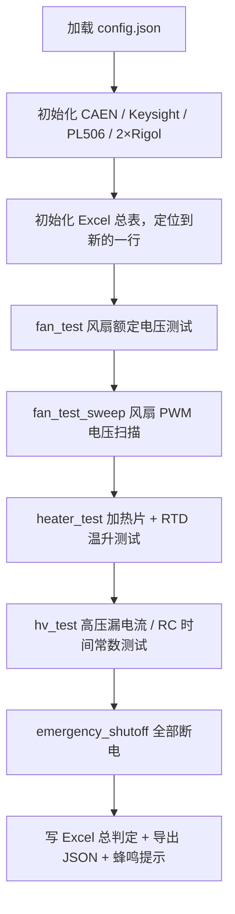
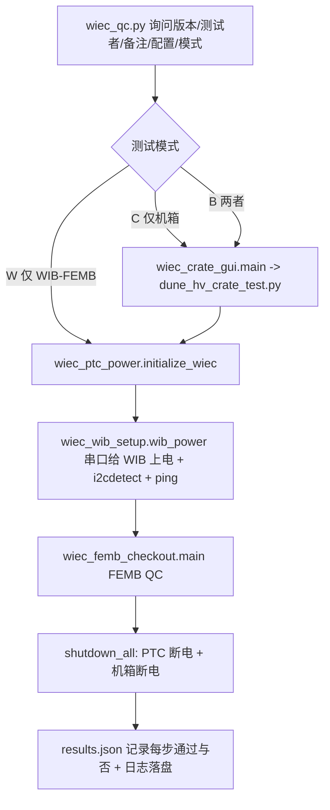

# DUNE-HV-Crate-Testing（DUNE 高压机箱自动化测试）

本仓库是 **DUNE HV Crate（高压机箱）产线自动化测试**代码，并在此基础上扩展出了
**WIEC / WIB / FEMB 整机 QC 流程** 与 **ISEG MPOD 高压模块 QC / 电性能测试** 三条相对独立的测试链。

所有脚本都在 Linux（Ubuntu）下运行，通过 **VISA(TCP/IP)**、**CAEN C 库(ctypes)**、**SNMP**、
**USB 串口**、**SSH**、**GPIB** 与各类仪器通信，自动完成测试、判定合格与否、并把结果写入
Excel / JSON / CSV / PNG。

---

## 目录

1. [快速开始](#1-快速开始)
2. [测试台硬件与仪器拓扑](#2-测试台硬件与仪器拓扑)
3. [主测试脚本 `dune_hv_crate_test.py`](#3-主测试脚本-dune_hv_crate_testpy)
4. [通道映射与继电器逻辑](#4-通道映射与继电器逻辑)
5. [输出文件结构](#5-输出文件结构)
6. [`config.json` 参数说明](#6-configjson-参数说明)
7. [底层仪器驱动模块](#7-底层仪器驱动模块)
8. [WIEC / WIB / FEMB QC 子系统](#8-wiec--wib--femb-qc-子系统)
9. [ISEG MPOD 高压模块相关脚本](#9-iseg-mpod-高压模块相关脚本)
10. [辅助与实验性脚本](#10-辅助与实验性脚本)
11. [完整目录结构](#11-完整目录结构)
12. [注意事项与已知问题](#12-注意事项与已知问题)

---

## 1. 快速开始

```bash
./setup.sh                                  # 建立 venv 并安装 requirements.txt 里的依赖
source venv/bin/activate
# 按需修改 config.json（IP 地址、判定阈值、被测通道等）

python3 dune_hv_crate_test.py config.json                 # 运行后交互式输入测试名
python3 dune_hv_crate_test.py config.json 测试名           # 或直接把测试名作为第二个参数
```

也可以走带菜单的上层入口：

```bash
python3 wiec_crate_gui.py    # 终端向导：版本号/测试者/备注 -> 自动生成测试名 -> 调用主脚本
python3 wiec_qc.py           # 整套 WIEC QC 序列（HV 机箱 / WIB-FEMB / 两者都测）
```

### CAEN HV Wrapper 库版本

某些 Ubuntu 版本下使用最新的 `libcaenhvwrapper.so.6.6` 会因为找不到 `libcrypto.so.1.1` 而报错，
因此仓库同时提供 6.3 与 6.6 两个版本，可通过 `config.json` 中的 `caenR8033DM_driver` 切换
（当前默认为 `libcaenhvwrapper.so.6.6`；若通信异常可改回 `libcaenhvwrapper.so.6.3`）。
`libcrypto.so.1.1` 问题的解决思路参考 [这里](https://stackoverflow.com/a/72507864)。

---

## 2. 测试台硬件与仪器拓扑

| 仪器 | 型号 | 通信方式 | 在测试中的角色 |
|---|---|---|---|
| 高压电源 | CAEN R8033DM（16 通道） | TCP/IP + CAEN C 库（ctypes） | 给被测 PCB 加 ±2000 V（开路）/ ±20 V（10 kΩ 端接），并回读 VMon/IMon |
| 数据采集 | Keysight DAQ970A | VISA over TCP/IP | 901A 卡：RTD 测温、加热片电阻、风扇 PWM 频率；907A 卡：数字输出字节驱动继电器 |
| 直流电源 0 | Rigol DP832A #0 | VISA over TCP/IP | CH1 风扇供电、CH2 加热片供电、CH3 加热开关 |
| 直流电源 1 | Rigol DP832A #1 | VISA over TCP/IP | CH4/CH5 高压继电器 pull-up、CH6 风扇 readback pull-up |
| PTC 电源 | Wiener PL506 | SNMP（`snmpget/snmpset` 子进程） | 给 WIEC 的 PTC 供 48 V |
| ISEG 高压 | ISEG MPOD / PMOD | SNMP（WIENER-CRATE-MIB） | ISEG 高压模块 QC 与电性能测试 |
| 万用表/DAQ | Agilent 34970A | GPIB | ISEG ramp-rate 测试时高速采电压 |

IP 地址集中在 `config.json`（备份在 `ip_addresses.json`）中配置。

---

## 3. 主测试脚本 `dune_hv_crate_test.py`

核心类 `LDOmeasure`（历史命名，实际是整机测试流程控制器，约 1500 行）。
`__init__` 里就把整个测试跑完：先初始化所有仪器（这样缺仪器时能立刻报错而不是等用户输入完再报），
再依次执行四大测试，任何异常都会先 `emergency_shutoff()` 断电再抛出。



### 3.1 `fan_test()` — 风扇基本测试

1. Keysight 切到频率测量模式（新风扇为 PWM 转速回读），Rigol0 打开 `fan`（24 V），Rigol1 打开 `fanread`（5 V 上拉）。
2. 等待 `fan_wait` 秒到稳态，测风扇供电电压/电流、上拉电源电压/电流、6 路风扇 RD 信号（连测两遍取后一次）。
3. 判据：`fan_voltage_min/max`、`fan_current_min/max`、`fan_read_min/max`。
4. 结果写入 Excel 第 4、5 列与第 6–11 列；不合格的单元格标红并置 `fan_test_result = False`。

> `write_to_spreadsheet=False` 时该函数退化为“纯测量”，供扫描测试复用，不会污染额定工况那一行结果。

### 3.2 `fan_test_sweep()` — 风扇 PWM 电压扫描

- 从 `rigol832a_fan_voltage_min` 到 `_max` 取 `rigol832a_fan_voltage_number_of_data_samples` 个点（至少 2 点，会做配置合法性检查）。
- 每个电压点重设 Rigol 输出 → 调用 `fan_test()` 取一次测量 → 记录「编程电压 / 实测电压 / 实测电流 / 各风扇振荡频率」。
- 产出：每个风扇一张 `电压-频率` 曲线 PNG、`编程电压-实测电压`、`编程电压-实测电流` 两张 PNG，
  一份单行 CSV，以及写回 Excel 的单行数据（列数 = 风扇数 × 扫描点数 × 4）。
- 若 Excel 老文件没有 PWM 列，`ensure_fan_pwm_columns()` 会在「风扇 RD」与「加热」区之间自动插入列并搬移旧数据。

### 3.3 `heater_test()` — 加热片与温升测试

1. **不加电**先用四线/两线电阻档测 4 片加热元件电阻，判据 `heating_element_min/max`（14–20 Ω）。
2. 切到 RTD 模式记录初始温度 `temp1`。
3. 打开 `heat_supply`（12 V）与 `heat_switch`（5 V）→ 等 `heat_wait` 秒 → 记录 `temp2`。
4. 温升 `temp2 - temp1` 判据 `temp_increase_min/max`（1–5 °C），写入 Excel 加热区 8 列。

### 3.4 `hv_test()` / `hv_test_single()` — 高压测试（核心）

对每个被测 PCB 通道，按 **8 段**顺序测量（正/负 × 开路/10 kΩ端接 × 上升/下降）：

| 阶段 | 电压 | 端接 | 采集时长 |
|---|---|---|---|
| `pos_open_on` / `pos_open_off` | +2000 V（`caenR8033DM_open_voltage`） | 开路 | `hv_minutes_duration_long`（5 min） |
| `pos_term_on` / `pos_term_off` | +20 V（`caenR8033DM_term_voltage`） | 10 kΩ | `hv_minutes_duration_short`（1 min） |
| `neg_open_on` / `neg_open_off` | −2000 V | 开路 | long |
| `neg_term_on` / `neg_term_off` | −20 V | 10 kΩ | short |

每一段的流程都是：设置 CAEN 电压 → 切继电器 → 开/关高压并等待 ramp 完成 →
`record_hv_data()` 按 `hv_seconds_interval`（20 s）扫描全部 16 通道的 V/I 存 CSV →
`hv_curve_fit()` 做指数拟合 → `make_plot()` 出图。

**判定量：**

- **绝缘/漏电电阻** `R = V / I`（V 单位 V，I 单位 µA ⇒ R 单位 **MΩ**）
  - 开路：`hv_resistance_open_min/max` = 5E3–150E3 MΩ（即 5–150 GΩ 漏电水平）
  - 端接：`hv_resistance_term_min/max` = 0.055–0.065 MΩ（55–65 kΩ，对应 10 kΩ 端接 + RC 滤波 49.9 kΩ 串联电阻）
- **RC 建立时间**：对电流（上升沿）或电压（下降沿）拟合 `a·exp(−b·t) + c`，
  判据比较的是 **b**（`hv_tau_min/max` = 0.01–0.03），写入 Excel 的是 **τ = 1/b**（秒）。

**容错设计：** `ConnectionResetError` / `BrokenPipeError` 会触发
`self.c.turn_off(range(16), emergency=True)` + `reset_pyvisa_connections()`（重新打开两台 Rigol 和 Keysight），
然后重试；同一通道最多重试一次，仍失败则整体断电并抛出。

### 3.5 `initialize_wiec()` / `shutdown_wiec()`

WIEC 相关的 PTC 上电逻辑（主脚本中默认注释掉，由 `wiec_ptc_power.py` 单独调用）：
先确认所有风扇的振荡频率高于 `fan_osc_freq`（300 Hz），**风扇确认在转之后**才通过 SNMP 打开 PL506 的 48 V 通道；
关机顺序相反（先关 PL506 再关风扇），保证散热安全。

---

### 3.6 WIEC_Component —— 按测试项拆分的版本

`dune_hv_crate_test.py` 把四个阶段焊死在一个 1500 行的 `__init__` 里，只能整套跑。
`WIEC_Component/` 是同一套测试按**测试项**拆开的版本，可以单项运行、按需组合：

| 模块 | KEY | 内容 | 约需 |
|---|---|---|---|
| `WIEC_Component/fan_test.py` | `fan_test` | 额定电压下风扇 V/I 与 6 路 RD | 1 min |
| `WIEC_Component/fan_pwm_sweep.py` | `fan_pwm_sweep` | 风扇电压扫描与 PWM 频率曲线 | 3 min |
| `WIEC_Component/heater_test.py` | `heater_test` | 加热片电阻与 RTD 温升 | 1 min |
| `WIEC_Component/hv_test.py` | `hv_test` | 高压 8 段（正/负 × 开路/10 kΩ × 升/降） | ~28 min |
| `WIEC_Component/ptc_power.py` | `ptc_power` | 风扇联锁的 PL506 48 V 上电（WIEC PTC 专用） | 1 min |

支撑模块：`session.py`（配置/仪器/结果目录/断电）、`spreadsheet.py`（Excel 列布局）、
`analysis.py`（指数拟合与绘图）、`preflight.py`（开测前检查与首次运行提示）、`cli.py`（单项独立入口）。

**顶层脚本**（在仓库根目录运行）：

```bash
python3 run_wiec_component.py                   # 菜单，逐项选择
python3 run_wiec_component.py --all             # 依次跑完 4 个机箱测试项
python3 run_wiec_component.py --items fan_test,heater_test
python3 run_wiec_component.py --list            # 列出所有测试项
python3 run_wiec_component.py --suggest         # 重看首次运行提示
python3 run_wiec_component.py --preflight       # 只做开测前检查
python3 run_wiec_component.py --shutdown        # 一条命令按安全顺序全部断电
```

单项也可以自己跑（各自建立独立的结果目录和表格行）：

```bash
python3 -m WIEC_Component.heater_test config.json my_test_name
```

**菜单里的选项**：数字选测试项（可空格分隔多选）、`a` 跑完全部、`p` 重做开测前检查、
`h` 重看提示、`s` 立即全部断电、`f` 结束本次会话并写总判定、`q` 退出（会先安全收尾）。

**会话语义**：顶层脚本开着期间，所有测试项写入**同一行 Excel、同一个结果目录**；
选 `f` 或退出时才写总判定并导出 JSON。单项独立运行则各自新建一行。

**首次运行**会自动打印一段提示（开测前检查清单、建议顺序、耗时预估、中止方式、结果位置、
以及 `fan_read_min/max` 单位存疑和 `hv_tau` 比较的是 b 这两个坑），之后不再重复，
可用 `--suggest` 或菜单 `h` 再看。运行记录在 `.wiec_component_state.json`。

**相对原脚本的行为差异**（都是有意为之）：

- `emergency_shutoff()` 每一步独立容错，某一步失败不再中断后续断电，并在结尾汇总哪几步失败
- 高压 ramp 的重连重试次数上限为 5（可用 `hv_max_connection_retries` 配置），耗尽即抛错断电，不再无限重试
- `record_hv_data` 采样间隙加了 `sleep(0.2)`，不再空转占满一个 CPU 核
- 加热测试用 `try/finally` 保证异常时加热器一定断电
- 风扇扫描结束后把 `rigol832a_fan_voltage` 恢复为额定值；JSON 存档的是启动时的配置快照
- 风扇 RD 失败项现在也会写进 JSON（原来失败项直接缺失）
- 命名样式缺失时自动补建，不会因为旧表格没有 `fail` 样式而整轮丢失
- 正端接电压/电流与负端接一样读两次，避免读到过期值

**保持不变**：Excel 列布局（与生产表格逐格比对，232 个表头单元格 0 处差异）、
所有判定阈值、拟合方式（与原实现在同一批 CSV 上比对，拟合参数差值为 0）。

## 4. 通道映射与继电器逻辑

**PCB 通道 → CAEN 通道** 在 `config.json` 中解耦配置：

```
pcb_ch_i_pos = i        # PCB 第 i 路的正高压 -> CAEN 通道 0..7
pcb_ch_i_neg = i + 8    # PCB 第 i 路的负高压 -> CAEN 通道 8..15
```

**继电器控制**由 Keysight 907A 数字输出卡的两个字节完成：`set_relay(hv, term)`

- 字节 1（`{slot}01`，参数 `hv`）：选择该通道走**正**（bit=0）还是**负**（bit=1）高压支路
- 字节 2（`{slot}02`，参数 `term`）：选择**开路**（bit=1）还是 **10 kΩ 端接**（bit=0）

`relay_setting` 由被测通道号按位组合而成（`relay_setting |= 1 << i`），所以支持
`simultaneous_test = "True"` 时 8 个通道同时测量，大幅缩短产线节拍。

---

## 5. 输出文件结构

```
results/
├── DUNE_HV_Crate_Production_Test.xlsx      # 所有测试累积的总表，一次测试 = 一行
└── 20260602141811/                         # 每次测试一个时间戳目录
    ├── 20260602141811_<测试名>.json        # 完整数据存档（含本次使用的全部配置）
    ├── <测试名>_chs0_1_..._pos_open_on.csv # 各阶段 16 通道 V/I 时间序列
    ├── <测试名>_..._ch0.png                # 每通道每阶段的 电流/电压-时间 双轴图
    └── fan PWM results/
        ├── fan_1_voltage_vs_frequency.png ...
        ├── programmed_voltage_vs_read_voltage.png
        ├── programmed_voltage_vs_read_current.png
        └── fan_pwm_results.csv
```

### Excel 总表列布局（列号由 `initialize_spreadsheet()` 动态计算）

| 列 | 内容 |
|---|---|
| 1–3 | 测试名（绿=通过 / 红=失败）、日期、时间 |
| 4–5 | 风扇供电电压 / 电流 |
| 6–11 | Fan 1–6 RD 信号 |
| 12 起 | Fan PWM 扫描区：`风扇数 × 扫描点数 × 4` 列（编程电压/实测电压/实测电流/频率） |
| 之后 8 列 | TC1–4 加热片电阻、TC1–4 温升 |
| 再之后 96 列 | HV 区：每个通道 12 列（`Ch{i}± Open Res / Open Fit On / Open Fit Off / 10k Res / 10k Fit On / 10k Fit Off`） |

测试名单元格**开始时先标红**，只有全部子测试通过、脚本正常跑完才会被改成绿色 —— 中途崩溃的测试
在表里天然显示为 fail。样式（`top` / `pass` / `fail`）作为 NamedStyle 一次性写入工作簿。

---

## 6. `config.json` 参数说明

| 分组 | 关键参数 | 含义 |
|---|---|---|
| 输出 | `output_directory` `output_file` `relative` `sheet_name` `rounding_factor` | 结果目录/Excel 文件名/是否相对脚本路径/表名/小数位 |
| 时序 | `hv_stability_wait` `hv_termination_wait` `hv_minutes_duration_long/short` `hv_seconds_interval` `heat_wait` `fan_wait` | 各阶段等待与采样间隔 |
| 风扇判据 | `fan_voltage_min/max` `fan_current_min/max` `fan_read_min/max` `fan_osc_freq` | 供电与 RD 信号窗口 |
| 风扇扫描 | `rigol832a_fan_voltage_min/max` `..._number_of_data_samples` | 扫描范围与点数 |
| 加热判据 | `heating_element_min/max` `temp_increase_min/max` | 加热片电阻（Ω）与温升（°C） |
| 高压判据 | `hv_resistance_open_min/max` `hv_resistance_term_min/max` `hv_tau_min/max` | 单位分别为 MΩ、MΩ、1/s |
| 通道 | `channels_to_test` `simultaneous_test` `pcb_ch_*_pos/neg` | 被测通道、是否并行、PCB↔CAEN 映射 |
| RC 滤波 | `rc_filter_ch0_3_r_ohm/c_f` `rc_filter_ch4_7_*` `rc_filter_termination_ohm` 及各 tolerance | 理论 RC 参数（ch0–3：49.9 kΩ/0.03 µF；ch4–7：24 kΩ/0.1 µF） |
| CAEN | `caenR8033DM*` | IP、驱动库、电流量程、过流、掉电模式、ramp 速率、trip 时间、开路/端接测试电压 |
| Keysight | `keysight970a*` | 资源串、901A/907A 槽位、RTD/加热/风扇通道号、NPLC、延时等 |
| Rigol | `rigol832a*` | 两台电源的资源串，以及 fan / heater_supply / heater_switch / hvpullup / hvpullup2 / fanread 六路的电压、电流、过流保护 |
| PL506 | `PL506_*` `WIEC_fan_*` | PTC 电源 IP、48 V 设定、限流与安全上限 |

---

## 7. 底层仪器驱动模块

| 文件 | 说明 |
|---|---|
| `caen_r8033dm.py` | **CAEN 底层驱动**。用 `ctypes` 直接加载 `libcaenhvwrapper.so.*`，封装 `CAENHV_InitSystem` / 板卡与通道属性枚举 / `Get|SetChParam` 等。启动时自动读取 crate、board、channel 的全部参数元信息（名称、类型、单位、可选状态），供上层按名字读写。 |
| `caen_r8033dm_wrapper.py` | **CAEN 高层封装**。开机自检（互锁 `BdIlk`、板卡状态），统一设置 16 通道的量程/过流/ramp/trip；提供 `turn_on/turn_off/power_cycle/wait_for_ramp`，在 ramp 过程中轮询状态并把状态字 >0x7 解析成具体故障；`get_voltage/get_current` 等读回参数。 |
| `keysight_daq970a.py` | DAQ970A 驱动。三种测量态（`rtd` / `resistance` / `fan` 频率）互斥，切换时用 `CONFigure` 重建扫描列表并记录 `self.state`，防止串测；`set_relay(hv, term)` 输出继电器控制字节；测量结果按「通道号→序号」字典返回。 |
| `rigol_dp832a.py` | DP832A 驱动。用 `setup_xxx()` 给通道**登记名字**（fan/heat_supply/…），之后一律按名字操作；两台电源用 `index` 区分，全局通道号 1–6 会自动换算成本机 1–3，调错电源会立即告警。 |
| `pl506.py` | Wiener PL506 SNMP 驱动。通过 `snmpget/snmpset/snmpwalk` 子进程 + WIENER-CRATE-MIB 读写；`safe_turn_on_channel()` 带电压/电流上限硬校验，超限直接拒绝。 |
| `KeysightE36312A_interfacing.py` | Keysight E36312A 的“同接口替换”驱动（SCPI 语法从 `SOUR1:...` 改为 `SOUR:...,(@1)`），用于 Rigol 缺货时顶替，配 `keysight_dropin_test.py` 做冒烟测试。 |

---

## 8. WIEC / WIB / FEMB QC 子系统

这一组脚本把 HV 机箱测试与 WIB/FEMB 的整机检查串成一条产线流程。入口是 **`wiec_qc.py`**：



| 文件 | 作用 |
|---|---|
| `wiec_qc.py` | 顶层编排器。按模式生成测试步骤表，用 `importlib` 动态调用各步骤函数；任一步失败即中止并写 `results.json`；`finally` 里始终执行 `shutdown_all()`。 |
| `wiec_crate_gui.py` | 终端向导：校验输入、按 `v{版本}_{测试者}_{备注}` 生成规范测试名、选择 config 文件，并调用 `dune_hv_crate_test.py`（含 `shutoff` 单独断电入口）。 |
| `wiec_ptc_power.py` | PTC 上下电：确认风扇转速合格后打开 PL506 48 V；关机时先关 PL506 再关风扇。 |
| `wiec_serial.py` | 通过 USB 串口（`/dev/ttyUSB*`，115200）登录 WIEC 的 PetaLinux：自动发现串口、登录、设置时间/timing、`power_wib`、`i2cdetect` 读取传感器地址。 |
| `wiec_wib_setup.py` | WIB 上电与连通性验证：校验 WIB 号（0–5）与电源状态，比对 i2cdetect 地址是否符合预期，ping `10.73.137.(71+n)` 确认 WIB 网络就绪。 |
| `wiec_femb_checkout.py` | FEMB 检查主流程：读 `init_setup.csv`、扫码录入 4 个槽位的 FEMB ID、调用 `qc_utils.QC_Process` 执行检查、汇总结果并邮件通知。 |
| `cts_ssh_FEMB.py` | 最大的一个模块（约 1200 行）：通过 SSH 驱动 Windows 侧 DAQ 机器（`D:/FEMB_QC/`）跑 FEMB QC 脚本，封装 `subrun()` 统一处理超时/返回码/关键字判定。 |
| `qc_utils.py` / `qc_results.py` | QC 通用工具（计时器、倒计时、fault 文件扫描）与结果分析展示（按槽位统计 pass/fault、彩色终端报告、重试逻辑）。 |
| `wiec_output_log.py` | 全流程日志：用 `Tee` 把 stdout/stderr 同时写入 `wiec output logs/` 下的文件，并提供静音区段与带倒计时的 sleep。 |
| `wiec_petalinux_debug.py` | PetaLinux/PTC 调试用的精简版上下电脚本。 |
| `GUI/`、`components/`、`FEMB_chk/` | 邮件发送（`send_email.py`）、Rigol DP800 USB 控制、装配日志、FEMB QC 数据落地目录。 |

配置来源：`init_setup.csv`（测试站点、协调人、数据根目录、CTS LN2 时间等）、
`femb_info.csv`（本次 4 个槽位的 FEMB 编号与测试者信息）、`results.json`（各步骤通过状态）。

---

## 9. ISEG MPOD 高压模块相关脚本

| 文件 | 作用 |
|---|---|
| `iseg_pmod_wrapper_QC.py` | ISEG MPOD 的 SNMP 封装：模块自动发现、解析型号/序列号/固件、通道健康检查、读写电压电流与 ramp rate、`monitor_channel_ramp()` 实测 ramp 速率并与设定值比对（容差 10%/5%），异常抛 `RampVerificationError`。带重试（`MAX_SNMP_RETRIES = 3`）。 |
| `iseg_pmod_qc.py` | PMOD 模块 **QC 主流程**：交互选择模块与极性 → 通信测试 → 初始读回测试 → 设置到极限值测试；结果追加到 `HV Modules Test Results/iseg_hv_modules_qc_results.csv`，终端日志存 `HV PMOD QC Output Text Files/`，ramp 告警存 `HV PMOD QC Ramp Warnings/`。 |
| `iseg_control.py` | 更精简的 ISEG SNMP 控制类，供电性能测试脚本调用。 |
| `iseg_HV_electrical_test.py` | **电性能测试**：① IV 测试（50/100/200/500/1000/1500/2000 V 逐点测电流）；② Ramp rate 测试（10 V/s 与 100 V/s 各升降到 1000 V，用 GPIB 接的 34970A 以 ~17 ms 间隔采样，线性拟合求实际 ramp 速率并出图）。采集用 `multiprocessing` 独立进程，结果存 `ISEG_E-Tests_RampRate/<时间戳>_<速率>_<电压>/`。 |

---

## 10. 辅助与实验性脚本

| 文件 | 作用 |
|---|---|
| `dune_hv_crate_test_negative_first.py` | 主脚本变体：把**负高压段提前**（正开路→负开路→负端接→正下降→正端接），用于排查正负极性顺序引起的过冲问题。 |
| `dune_hv_negative_10k_meas_testing.py` | 主脚本变体：注释掉正高压部分，只专注负高压 10 kΩ 端接的测量调试。 |
| `hv_crate_characterization.py` | 特性刻画脚本：单通道 0→120 V 每 1 V 停 60 s 扫描（输出 `*_scan_voltage.csv`），以及 16 通道同时加压的长时间监测。仓库里的 `da_scan_voltage.csv`、`shorted_scan_voltage.csv`、`60s_time_scan_voltage.csv` 即其产物。 |
| `just_plot.py` | 只重绘不测量：复用 `LDOmeasure` 的绘图函数，对已有 `results/<时间戳>/` 目录重新出图，或把多次测试叠在一张图上对比。 |
| `hv_testing.py` | 极简脚本：把 CAEN 通道 1–15 设到 2000 V，用于快速验证通信。 |
| `new_fans_test.py` | 新风扇（带 PWM 回读）的独立验证脚本。 |
| `test_pl506_read.py` / `test_pl506_write.py` / `pl506_write_off.py` | PL506 的读/写/关断小工具。 |
| `34970A-DAQ/34970a_check.py` | 34970A 的 GPIB 连通性与读数检查。 |
| `caen_r8033dm backup.py` | CAEN 驱动的历史备份，不参与运行。 |
| `overshoot_02182025.txt` | 过冲问题的调试记录。 |

---

## 11. 完整目录结构

```
DUNE-HV-Crate-Testing/
├── run_wiec_component.py          # ★ 按测试项运行的顶层脚本
├── WIEC_Component/                # ★ 拆分后的测试项
│   ├── session.py                 #   会话：配置/仪器/结果/断电
│   ├── spreadsheet.py             #   Excel 列布局
│   ├── analysis.py                #   指数拟合与绘图
│   ├── preflight.py               #   开测前检查与首次运行提示
│   ├── cli.py                     #   单项独立入口
│   ├── fan_test.py  fan_pwm_sweep.py
│   └── heater_test.py  hv_test.py  ptc_power.py
├── dune_hv_crate_test.py          # ★ 原主测试脚本（未改动）
├── config.json                    # ★ 全部配置与判定阈值
├── setup.sh / requirements.txt    # 环境搭建
├── caen_r8033dm.py                # CAEN 底层 ctypes 驱动
├── caen_r8033dm_wrapper.py        # CAEN 高层封装
├── keysight_daq970a.py            # DAQ970A 驱动（测量 + 继电器）
├── rigol_dp832a.py                # DP832A 驱动
├── pl506.py                       # Wiener PL506 SNMP 驱动
├── libcaenhvwrapper.so.6.3/6.6    # CAEN C 库（两个版本）
│
├── wiec_qc.py                     # WIEC QC 顶层编排
├── wiec_crate_gui.py              # 终端向导
├── wiec_ptc_power.py              # PTC 上下电
├── wiec_serial.py                 # PetaLinux 串口控制
├── wiec_wib_setup.py              # WIB 上电与连通性
├── wiec_femb_checkout.py          # FEMB 检查流程
├── cts_ssh_FEMB.py                # 远程 FEMB QC（SSH）
├── qc_utils.py / qc_results.py    # QC 工具与结果分析
├── wiec_output_log.py             # 日志 Tee
│
├── iseg_pmod_qc.py                # ISEG PMOD QC 主流程
├── iseg_pmod_wrapper_QC.py        # ISEG SNMP 封装（QC 版）
├── iseg_control.py                # ISEG SNMP 封装（精简版）
├── iseg_HV_electrical_test.py     # ISEG IV + ramp rate 测试
│
├── results/                       # HV 机箱测试结果（Excel + 每次测试目录）
├── HV Modules Test Results/       # ISEG 模块 QC 汇总 CSV
├── HV PMOD QC Output Text Files/  # ISEG QC 终端日志
├── HV PMOD QC Ramp Warnings/      # ISEG ramp 告警
├── ISEG_E-Tests_RampRate/         # ISEG 电性能测试结果
├── wiec output logs/              # WIEC QC 日志
├── FEMB_chk/                      # FEMB QC 数据根目录
├── GUI/ components/ 34970A-DAQ/   # 邮件、装配日志、34970A 工具
└── venv/                          # 虚拟环境（不入库）
```

---

## 12. 注意事项与已知问题

**安全相关**

- 任何异常路径都会先调用 `emergency_shutoff()`：**先关 16 路高压 → 关加热 → 关 PL506 → 关风扇 → 复位继电器**。
  修改流程时务必保持这个顺序（尤其是 PL506 必须早于风扇关闭）。
- `hv_test()` 里对断线异常做了重连重试，但**重试仍失败时会整体断电并抛异常**，不要把 `raise` 去掉。
- PL506 的 `safe_turn_on_channel()` 有电压/电流硬上限校验，`config.json` 中的
  `PL506_voltage_max` / `PL506_current_max` 是最后一道防线。

**配置相关**

- `fan_read_min/max`（1.1–2.5）看起来是旧款风扇**电压回读**时代的阈值，而 `initialize_fan()` 现在配置的是
  **频率测量**（`CONFigure:FREQuency`），`initialize_wiec()` 用的是 `fan_osc_freq = 300` Hz。
  换用新风扇后 `fan_test()` 的这条判据需要重新核对，否则会误判为 fail。
- `hv_tau_min/max` 名字叫 tau，但比较的是拟合参数 **b（1/秒）**，写进表格的才是 τ=1/b，改阈值时别弄反。
- `hv_resistance_*` 的单位是 **MΩ**（因为 CAEN 电流读数是 µA）。
- `config.json` 中 `rc_filter_*` 一组参数目前只作为理论值记录，主脚本并未用它们做自动比对。
- Excel 表结构由 `fan_rd_first_col` / `fan_pwm_first_col` / `tc_res_first_col` / `hv_res_first_col`
  一路推算而来，**改动风扇数或扫描点数会改变整张表的列布局**；老文件会被 `ensure_fan_pwm_columns()` 自动升级。

**仓库卫生**

- 仓库里没有 `.gitignore`，`venv/`、`__pycache__/`、`results/`、各类测试输出目录目前都是未跟踪状态，
  提交前请注意不要误加。
- `dune_hv_crate_test*.py` 有三个变体（主版本、negative_first、negative_10k），修 bug 时注意是否需要同步。
