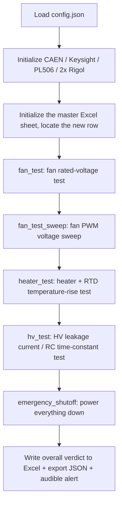
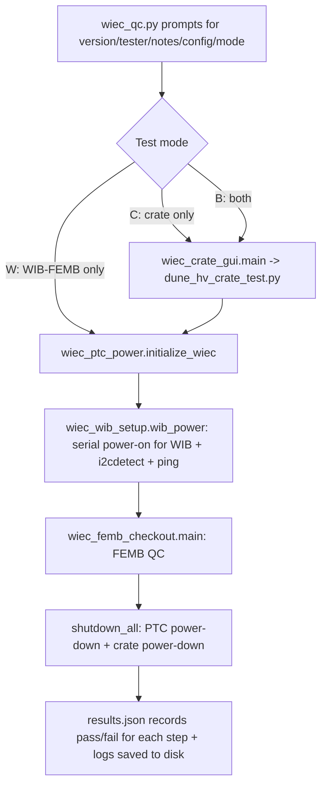

# DUNE-HV-Crate-Testing (DUNE High-Voltage Crate Automated Testing)

This repository contains the **automated production-line test code for the DUNE HV Crate (high-voltage crate)**, extended with three relatively independent test chains built on top of it:
**WIEC / WIB / FEMB full-unit QC flow** and **ISEG MPOD high-voltage module QC / electrical performance testing**.

All scripts run under Linux (Ubuntu) and communicate with the various instruments via **VISA (TCP/IP)**, the **CAEN C library (ctypes)**, **SNMP**, **USB serial**, **SSH**, and **GPIB**. They automatically run the tests, determine pass/fail, and write results to Excel / JSON / CSV / PNG.

---

## Table of Contents

1. [Quick Start](#1-quick-start)
2. [Test Bench Hardware and Instrument Topology](#2-test-bench-hardware-and-instrument-topology)
3. [Main Test Script `dune_hv_crate_test.py`](#3-main-test-script-dune_hv_crate_testpy)
4. [Channel Mapping and Relay Logic](#4-channel-mapping-and-relay-logic)
5. [Output File Structure](#5-output-file-structure)
6. [`config.json` Parameter Reference](#6-configjson-parameter-reference)
7. [Low-Level Instrument Driver Modules](#7-low-level-instrument-driver-modules)
8. [WIEC / WIB / FEMB QC Subsystem](#8-wiec--wib--femb-qc-subsystem)
9. [ISEG MPOD High-Voltage Module Scripts](#9-iseg-mpod-high-voltage-module-scripts)
10. [Auxiliary and Experimental Scripts](#10-auxiliary-and-experimental-scripts)
11. [Full Directory Structure](#11-full-directory-structure)
12. [Notes and Known Issues](#12-notes-and-known-issues)

---

## 1. Quick Start

```bash
./setup.sh                                  # create venv and install dependencies from requirements.txt
source venv/bin/activate
# edit config.json as needed (IP addresses, pass/fail thresholds, channels under test, etc.)

python3 dune_hv_crate_test.py config.json                 # run and enter the test name interactively
python3 dune_hv_crate_test.py config.json test_name        # or pass the test name directly as the second argument
```

There are also higher-level menu-driven entry points:

```bash
python3 wiec_crate_gui.py    # terminal wizard: version/tester/notes -> auto-generates test name -> calls the main script
python3 wiec_qc.py           # full WIEC QC sequence (HV crate only / WIB-FEMB only / both)
```

### CAEN HV Wrapper Library Version

On some Ubuntu versions, using the latest `libcaenhvwrapper.so.6.6` fails because `libcrypto.so.1.1` cannot be found. For this reason the repository ships both the 6.3 and 6.6 versions, and you can switch between them via `caenR8033DM_driver` in `config.json`
(the current default is `libcaenhvwrapper.so.6.6`; if communication fails, switch back to `libcaenhvwrapper.so.6.3`).
For an approach to resolving the `libcrypto.so.1.1` issue, see [here](https://stackoverflow.com/a/72507864).

---

## 2. Test Bench Hardware and Instrument Topology

| Instrument | Model | Communication | Role in Testing |
|---|---|---|---|
| HV power supply | CAEN R8033DM (16 channel) | TCP/IP + CAEN C library (ctypes) | Applies ±2000 V (open circuit) / ±20 V (10 kΩ termination) to the PCB under test, and reads back VMon/IMon |
| Data acquisition | Keysight DAQ970A | VISA over TCP/IP | 901A card: RTD temperature measurement, heater resistance, fan PWM frequency; 907A card: digital output byte drives the relays |
| DC power supply 0 | Rigol DP832A #0 | VISA over TCP/IP | CH1 fan power, CH2 heater power, CH3 heater switch |
| DC power supply 1 | Rigol DP832A #1 | VISA over TCP/IP | CH4/CH5 HV relay pull-up, CH6 fan readback pull-up |
| PTC power supply | Wiener PL506 | SNMP (`snmpget`/`snmpset` subprocess) | Supplies 48 V to the WIEC's PTC |
| ISEG high voltage | ISEG MPOD / PMOD | SNMP (WIENER-CRATE-MIB) | ISEG HV module QC and electrical performance testing |
| Multimeter/DAQ | Agilent 34970A | GPIB | High-speed voltage sampling during ISEG ramp-rate testing |

IP addresses are centrally configured in `config.json` (backed up in `ip_addresses.json`).

---

## 3. Main Test Script `dune_hv_crate_test.py`

The core class is `LDOmeasure` (a legacy name — it's actually the full-unit test-flow controller, roughly 1500 lines).
The entire test run happens inside `__init__`: all instruments are initialized first (so a missing instrument raises an error immediately rather than after the user finishes entering input), then the four major tests are run in sequence. Any exception first triggers `emergency_shutoff()` to power down before re-raising.



### 3.1 `fan_test()` — Basic Fan Test

1. Keysight switches to frequency-measurement mode (for new fans, PWM speed readback); Rigol0 turns on `fan` (24 V), Rigol1 turns on `fanread` (5 V pull-up).
2. Wait `fan_wait` seconds for steady state, then measure fan supply voltage/current, pull-up supply voltage/current, and the 6 fan RD signals (measured twice, the second reading is used).
3. Pass/fail criteria: `fan_voltage_min/max`, `fan_current_min/max`, `fan_read_min/max`.
4. Results are written to Excel columns 4–5 and 6–11; failing cells are highlighted red and `fan_test_result` is set to `False`.

> When `write_to_spreadsheet=False`, this function degrades to a "measurement only" mode, reused by the sweep test so it doesn't pollute the rated-condition row of results.

### 3.2 `fan_test_sweep()` — Fan PWM Voltage Sweep

- Takes `rigol832a_fan_voltage_number_of_data_samples` points from `rigol832a_fan_voltage_min` to `_max` (at least 2 points; a configuration validity check is performed).
- At each voltage point: reset the Rigol output → call `fan_test()` to take one measurement → record "programmed voltage / measured voltage / measured current / each fan's oscillation frequency."
- Output: one "voltage-frequency" curve PNG per fan, plus a "programmed voltage vs. measured voltage" PNG and a "programmed voltage vs. measured current" PNG, a single-row CSV, and a single row of data written back to Excel (column count = number of fans × number of sweep points × 4).
- If an older Excel file lacks PWM columns, `ensure_fan_pwm_columns()` automatically inserts the columns between the "fan RD" and "heating" sections and migrates the old data.

### 3.3 `heater_test()` — Heater and Temperature-Rise Test

1. **With no power applied**, first measure the resistance of the 4 heater elements using the 4-wire/2-wire resistance range; pass/fail criterion `heating_element_min/max` (14–20 Ω).
2. Switch to RTD mode and record the initial temperature `temp1`.
3. Turn on `heat_supply` (12 V) and `heat_switch` (5 V) → wait `heat_wait` seconds → record `temp2`.
4. Temperature rise `temp2 - temp1` is checked against `temp_increase_min/max` (1–5 °C) and written to the 8 heater columns in Excel.

### 3.4 `hv_test()` / `hv_test_single()` — High-Voltage Test (Core)

For each PCB channel under test, measurements are taken in **8 stages**, in sequence (positive/negative × open-circuit/10 kΩ termination × ramp-up/ramp-down):

| Stage | Voltage | Termination | Acquisition Duration |
|---|---|---|---|
| `pos_open_on` / `pos_open_off` | +2000 V (`caenR8033DM_open_voltage`) | Open circuit | `hv_minutes_duration_long` (5 min) |
| `pos_term_on` / `pos_term_off` | +20 V (`caenR8033DM_term_voltage`) | 10 kΩ | `hv_minutes_duration_short` (1 min) |
| `neg_open_on` / `neg_open_off` | −2000 V | Open circuit | long |
| `neg_term_on` / `neg_term_off` | −20 V | 10 kΩ | short |

Each stage follows the same flow: set the CAEN voltage → switch the relay → turn the HV on/off and wait for the ramp to complete →
`record_hv_data()` scans V/I on all 16 channels at `hv_seconds_interval` (20 s) and stores them to CSV →
`hv_curve_fit()` performs an exponential fit → `make_plot()` produces the plot.

**Pass/fail quantities:**

- **Insulation/leakage resistance** `R = V / I` (V in volts, I in µA ⇒ R in **MΩ**)
  - Open circuit: `hv_resistance_open_min/max` = 5E3–150E3 MΩ (i.e., a leakage level of 5–150 GΩ)
  - Termination: `hv_resistance_term_min/max` = 0.055–0.065 MΩ (55–65 kΩ, corresponding to the 10 kΩ termination in series with the 49.9 kΩ RC filter resistor)
- **RC settling time**: current (rising edge) or voltage (falling edge) is fit to `a·exp(−b·t) + c`;
  the pass/fail check compares **b** (`hv_tau_min/max` = 0.01–0.03), while what's written to Excel is **τ = 1/b** (seconds).

**Fault tolerance:** `ConnectionResetError` / `BrokenPipeError` triggers
`self.c.turn_off(range(16), emergency=True)` + `reset_pyvisa_connections()` (reopening both Rigol units and the Keysight),
then a retry; each channel is retried at most once — if it still fails, the whole system powers down and the exception is re-raised.

### 3.5 `initialize_wiec()` / `shutdown_wiec()`

WIEC-related PTC power-on logic (commented out by default in the main script, called separately by `wiec_ptc_power.py`):
first confirm that every fan's oscillation frequency is above `fan_osc_freq` (300 Hz), and **only after the fans are confirmed spinning** does it turn on the PL506's 48 V channel via SNMP;
the shutdown order is reversed (PL506 off first, then the fans), to ensure safe cooling.

---

### 3.6 WIEC_Component — Version Split by Test Item

`dune_hv_crate_test.py` hard-codes the four stages into a single 1500-line `__init__`, which can only be run as a whole.
`WIEC_Component/` is the same set of tests split by **test item**, so individual items can be run, or combined as needed:

| Module | KEY | Contents | Approx. Time |
|---|---|---|---|
| `WIEC_Component/fan_test.py` | `fan_test` | Fan V/I and 6-channel RD at rated voltage | 1 min |
| `WIEC_Component/fan_pwm_sweep.py` | `fan_pwm_sweep` | Fan voltage sweep and PWM frequency curve | 3 min |
| `WIEC_Component/heater_test.py` | `heater_test` | Heater resistance and RTD temperature rise | 1 min |
| `WIEC_Component/hv_test.py` | `hv_test` | HV 8 stages (positive/negative × open/10 kΩ × up/down) | ~28 min |
| `WIEC_Component/ptc_power.py` | `ptc_power` | Fan-interlocked PL506 48 V power-on (WIEC PTC only) | 1 min |

Supporting modules: `session.py` (config/instruments/results directory/power-down), `spreadsheet.py` (Excel column layout),
`analysis.py` (exponential fitting and plotting), `preflight.py` (pre-test checks and first-run tips), `cli.py` (standalone entry point for individual items).

**Top-level scripts** (run from the repository root):

```bash
python3 run_wiec_component.py                   # menu, select items one by one
python3 run_wiec_component.py --all             # run all 4 crate test items in sequence
python3 run_wiec_component.py --items fan_test,heater_test
python3 run_wiec_component.py --list            # list all test items
python3 run_wiec_component.py --suggest         # show the first-run tips again
python3 run_wiec_component.py --preflight       # pre-test checks only
python3 run_wiec_component.py --shutdown        # power everything down in the safe order with a single command
```

Individual items can also be run on their own (each creates its own results directory and spreadsheet row):

```bash
python3 -m WIEC_Component.heater_test config.json my_test_name
```

**Menu options**: number keys select test items (space-separated for multiple selections), `a` runs everything, `p` redoes the pre-test check,
`h` shows the tips again, `s` immediately powers everything down, `f` ends the session and writes the overall verdict, `q` quits (performing a safe shutdown first).

**Session semantics**: while the top-level script is running, all test items write to the **same Excel row and the same results directory**;
the overall verdict is written and JSON exported only when you select `f` or quit. Running an item standalone creates a new row each time.

**On first run**, a block of tips is printed automatically (pre-test checklist, suggested order, time estimate, how to abort, where results go,
and the two gotchas — the uncertain units of `fan_read_min/max` and the fact that `hv_tau` compares against `b`). It isn't shown again afterward,
but can be viewed again via `--suggest` or the `h` menu option. Run state is recorded in `.wiec_component_state.json`.

**Behavioral differences from the original script** (all intentional):

- `emergency_shutoff()` now fault-tolerates each step independently — a failure in one step no longer aborts the remaining shutdown steps, and a summary of which steps failed is printed at the end
- The HV ramp reconnection retry count is now capped at 5 (configurable via `hv_max_connection_retries`); once exhausted it raises an error and powers down, rather than retrying indefinitely
- A `sleep(0.2)` was added between `record_hv_data` sampling intervals, so it no longer busy-waits and pins a full CPU core
- The heater test uses `try/finally` to guarantee the heater is powered off on any exception
- After the fan sweep finishes, `rigol832a_fan_voltage` is restored to its rated value; the JSON archive stores the configuration snapshot taken at startup
- Failed fan RD items are now also written to JSON (previously, failed items were simply missing)
- Missing named styles are now auto-created, so an old spreadsheet lacking a `fail` style no longer causes the whole run to be lost
- Positive termination voltage/current is now read twice, just like negative termination, to avoid reading a stale value

**Left unchanged**: the Excel column layout (compared cell-by-cell against the production spreadsheet — 0 differences across 232 header cells), all pass/fail thresholds, and the fitting method (compared against the original implementation on the same batch of CSVs — fit parameters differ by 0).

## 4. Channel Mapping and Relay Logic

**PCB channel → CAEN channel** is configured independently in `config.json`:

```
pcb_ch_i_pos = i        # PCB channel i's positive HV -> CAEN channel 0..7
pcb_ch_i_neg = i + 8    # PCB channel i's negative HV -> CAEN channel 8..15
```

**Relay control** is done via two bytes on the Keysight 907A digital output card: `set_relay(hv, term)`

- Byte 1 (`{slot}01`, parameter `hv`): selects whether that channel routes through the **positive** (bit=0) or **negative** (bit=1) HV branch
- Byte 2 (`{slot}02`, parameter `term`): selects **open circuit** (bit=1) or **10 kΩ termination** (bit=0)

`relay_setting` is built by combining the bits for the channels under test (`relay_setting |= 1 << i`), so when
`simultaneous_test = "True"`, all 8 channels can be measured at once, greatly shortening the production-line cycle time.

---

## 5. Output File Structure

```
results/
├── DUNE_HV_Crate_Production_Test.xlsx      # master sheet accumulating all tests, one test = one row
└── 20260602141811/                         # one timestamped directory per test
    ├── 20260602141811_<test_name>.json     # full data archive (including all config used for this run)
    ├── <test_name>_chs0_1_..._pos_open_on.csv # 16-channel V/I time series for each stage
    ├── <test_name>_..._ch0.png             # dual-axis current/voltage-vs-time plot for each channel/stage
    └── fan PWM results/
        ├── fan_1_voltage_vs_frequency.png ...
        ├── programmed_voltage_vs_read_voltage.png
        ├── programmed_voltage_vs_read_current.png
        └── fan_pwm_results.csv
```

### Master Excel Sheet Column Layout (column numbers computed dynamically by `initialize_spreadsheet()`)

| Columns | Contents |
|---|---|
| 1–3 | Test name (green = pass / red = fail), date, time |
| 4–5 | Fan supply voltage / current |
| 6–11 | Fan 1–6 RD signals |
| 12 onward | Fan PWM sweep block: `number of fans × number of sweep points × 4` columns (programmed voltage/measured voltage/measured current/frequency) |
| Next 8 columns | TC1–4 heater resistance, TC1–4 temperature rise |
| Next 96 columns | HV block: 12 columns per channel (`Ch{i}± Open Res / Open Fit On / Open Fit Off / 10k Res / 10k Fit On / 10k Fit Off`) |

The test-name cell **starts out highlighted red**, and is only changed to green once every sub-test passes and the script finishes running normally — a test that crashes partway through therefore naturally shows as a failure in the sheet. The styles (`top` / `pass` / `fail`) are written into the workbook once, as NamedStyles.

---

## 6. `config.json` Parameter Reference

| Group | Key Parameters | Meaning |
|---|---|---|
| Output | `output_directory` `output_file` `relative` `sheet_name` `rounding_factor` | Results directory / Excel filename / whether paths are relative to the script / sheet name / decimal places |
| Timing | `hv_stability_wait` `hv_termination_wait` `hv_minutes_duration_long/short` `hv_seconds_interval` `heat_wait` `fan_wait` | Wait times and sampling intervals for each stage |
| Fan criteria | `fan_voltage_min/max` `fan_current_min/max` `fan_read_min/max` `fan_osc_freq` | Supply and RD signal windows |
| Fan sweep | `rigol832a_fan_voltage_min/max` `..._number_of_data_samples` | Sweep range and number of points |
| Heater criteria | `heating_element_min/max` `temp_increase_min/max` | Heater resistance (Ω) and temperature rise (°C) |
| HV criteria | `hv_resistance_open_min/max` `hv_resistance_term_min/max` `hv_tau_min/max` | Units are MΩ, MΩ, and 1/s respectively |
| Channels | `channels_to_test` `simultaneous_test` `pcb_ch_*_pos/neg` | Channels under test, whether to test in parallel, PCB↔CAEN mapping |
| RC filter | `rc_filter_ch0_3_r_ohm/c_f` `rc_filter_ch4_7_*` `rc_filter_termination_ohm` and their tolerances | Theoretical RC parameters (ch0–3: 49.9 kΩ/0.03 µF; ch4–7: 24 kΩ/0.1 µF) |
| CAEN | `caenR8033DM*` | IP, driver library, current range, overcurrent, power-loss mode, ramp rate, trip time, open-circuit/termination test voltages |
| Keysight | `keysight970a*` | Resource string, 901A/907A slot positions, RTD/heater/fan channel numbers, NPLC, delays, etc. |
| Rigol | `rigol832a*` | Resource strings for the two supplies, plus voltage, current, and overcurrent protection for the six channels: fan / heater_supply / heater_switch / hvpullup / hvpullup2 / fanread |
| PL506 | `PL506_*` `WIEC_fan_*` | PTC power supply IP, 48 V setpoint, current limit, and safety ceiling |

---

## 7. Low-Level Instrument Driver Modules

| File | Description |
|---|---|
| `caen_r8033dm.py` | **Low-level CAEN driver.** Loads `libcaenhvwrapper.so.*` directly via `ctypes`, wrapping `CAENHV_InitSystem`, board/channel property enumeration, `Get|SetChParam`, etc. On startup it automatically reads all parameter metadata (name, type, unit, valid states) for the crate, board, and channels, so higher layers can read/write by name. |
| `caen_r8033dm_wrapper.py` | **High-level CAEN wrapper.** Performs a power-on self-check (interlock `BdIlk`, board status), uniformly configures range/overcurrent/ramp/trip for all 16 channels; provides `turn_on/turn_off/power_cycle/wait_for_ramp`, polling status during the ramp and decoding status words >0x7 into specific faults; also provides readback via `get_voltage/get_current`, etc. |
| `keysight_daq970a.py` | DAQ970A driver. The three mutually-exclusive measurement states (`rtd` / `resistance` / `fan` frequency) rebuild the scan list with `CONFigure` when switching and track `self.state` to prevent cross-contamination; `set_relay(hv, term)` outputs the relay control bytes; measurement results are returned as a "channel number → index" dictionary. |
| `rigol_dp832a.py` | DP832A driver. Uses `setup_xxx()` to **register names** for channels (fan/heat_supply/…), after which everything is operated by name; the two supplies are distinguished by `index`, and global channel numbers 1–6 are automatically translated to the local 1–3 for each unit — using the wrong supply raises an immediate warning. |
| `pl506.py` | Wiener PL506 SNMP driver. Reads/writes via `snmpget/snmpset/snmpwalk` subprocesses plus the WIENER-CRATE-MIB; `safe_turn_on_channel()` includes hard voltage/current ceiling validation and rejects out-of-range requests outright. |
| `KeysightE36312A_interfacing.py` | A "drop-in replacement" driver for the Keysight E36312A (SCPI syntax changed from `SOUR1:...` to `SOUR:...,(@1)`), used to substitute for the Rigol when it's unavailable, paired with `keysight_dropin_test.py` for smoke testing. |

---

## 8. WIEC / WIB / FEMB QC Subsystem

This group of scripts chains the HV crate test together with the WIB/FEMB full-unit checks into a single production-line flow. The entry point is **`wiec_qc.py`**:



| File | Purpose |
|---|---|
| `wiec_qc.py` | Top-level orchestrator. Generates the test-step table based on mode and dynamically calls each step's function via `importlib`; any step failing aborts the run and writes `results.json`; `shutdown_all()` always runs in the `finally` block. |
| `wiec_crate_gui.py` | Terminal wizard: validates input, generates a standardized test name in the form `v{version}_{tester}_{notes}`, selects the config file, and calls `dune_hv_crate_test.py` (including a standalone `shutoff` power-down entry point). |
| `wiec_ptc_power.py` | PTC power on/off: confirms fan speed is within spec before turning on the PL506's 48 V; on shutdown, turns off the PL506 before the fans. |
| `wiec_serial.py` | Logs into the WIEC's PetaLinux over USB serial (`/dev/ttyUSB*`, 115200): auto-discovers the serial port, logs in, sets time/timing, `power_wib`, and reads sensor addresses via `i2cdetect`. |
| `wiec_wib_setup.py` | WIB power-on and connectivity verification: validates the WIB number (0–5) and power state, compares `i2cdetect` addresses against expected values, and pings `10.73.137.(71+n)` to confirm the WIB network is ready. |
| `wiec_femb_checkout.py` | Main FEMB check flow: reads `init_setup.csv`, scans in the FEMB IDs for the 4 slots, calls `qc_utils.QC_Process` to run the checks, aggregates results, and sends an email notification. |
| `cts_ssh_FEMB.py` | The largest module (roughly 1200 lines): drives the Windows-side DAQ machine (`D:/FEMB_QC/`) over SSH to run the FEMB QC scripts, wrapping `subrun()` to handle timeouts, return codes, and keyword-based pass/fail determination uniformly. |
| `qc_utils.py` / `qc_results.py` | General QC utilities (timers, countdowns, fault-file scanning) and results analysis/display (per-slot pass/fault statistics, colored terminal reports, retry logic). |
| `wiec_output_log.py` | Full-flow logging: uses a `Tee` to write stdout/stderr simultaneously to files under `wiec output logs/`, and provides silent sections and a countdown-based sleep. |
| `wiec_petalinux_debug.py` | A stripped-down power on/off script for PetaLinux/PTC debugging. |
| `GUI/`, `components/`, `FEMB_chk/` | Email sending (`send_email.py`), Rigol DP800 USB control, assembly logs, and the FEMB QC data landing directory. |

Configuration sources: `init_setup.csv` (test site, coordinator, data root directory, CTS LN2 timing, etc.),
`femb_info.csv` (the current run's 4-slot FEMB IDs and tester information), `results.json` (pass/fail status of each step).

---

## 9. ISEG MPOD High-Voltage Module Scripts

| File | Purpose |
|---|---|
| `iseg_pmod_wrapper_QC.py` | SNMP wrapper for the ISEG MPOD: auto-discovers modules, parses model/serial number/firmware, checks channel health, reads/writes voltage/current and ramp rate; `monitor_channel_ramp()` measures the actual ramp rate and compares it against the setpoint (10%/5% tolerance), raising `RampVerificationError` on anomalies. Includes retries (`MAX_SNMP_RETRIES = 3`). |
| `iseg_pmod_qc.py` | Main **QC flow** for PMOD modules: interactively select module and polarity → communication test → initial readback test → set-to-limit-value test; results are appended to `HV Modules Test Results/iseg_hv_modules_qc_results.csv`, terminal logs are stored under `HV PMOD QC Output Text Files/`, and ramp warnings under `HV PMOD QC Ramp Warnings/`. |
| `iseg_control.py` | A leaner ISEG SNMP control class, used by the electrical-performance test scripts. |
| `iseg_HV_electrical_test.py` | **Electrical performance test:** ① IV test (current measured point-by-point at 50/100/200/500/1000/1500/2000 V); ② ramp-rate test (ramping up and down to 1000 V at both 10 V/s and 100 V/s, sampled at ~17 ms intervals via the GPIB-connected 34970A, with a linear fit used to compute the actual ramp rate and produce a plot). Acquisition runs in a separate `multiprocessing` process; results are stored under `ISEG_E-Tests_RampRate/<timestamp>_<rate>_<voltage>/`. |

---

## 10. Auxiliary and Experimental Scripts

| File | Purpose |
|---|---|
| `dune_hv_crate_test_negative_first.py` | Main-script variant that **runs the negative HV stage first** (positive-open → negative-open → negative-termination → positive-ramp-down → positive-termination), used to investigate overshoot issues caused by the positive/negative polarity order. |
| `dune_hv_negative_10k_meas_testing.py` | Main-script variant with the positive HV section commented out, focused solely on debugging the negative HV 10 kΩ termination measurement. |
| `hv_crate_characterization.py` | A characterization script: single-channel sweep from 0→120 V, holding 60 s at each 1 V step (produces `*_scan_voltage.csv`), plus long-duration monitoring with all 16 channels powered simultaneously. `da_scan_voltage.csv`, `shorted_scan_voltage.csv`, and `60s_time_scan_voltage.csv` in the repository are its outputs. |
| `just_plot.py` | Re-plots without measuring: reuses `LDOmeasure`'s plotting functions to regenerate plots for an existing `results/<timestamp>/` directory, or overlay multiple test runs on the same plot for comparison. |
| `hv_testing.py` | A minimal script that sets CAEN channels 1–15 to 2000 V, used for a quick communication check. |
| `new_fans_test.py` | A standalone verification script for the new fans (with PWM readback). |
| `test_pl506_read.py` / `test_pl506_write.py` / `pl506_write_off.py` | Small read/write/shutoff utilities for the PL506. |
| `34970A-DAQ/34970a_check.py` | GPIB connectivity and reading check for the 34970A. |
| `caen_r8033dm backup.py` | A historical backup of the CAEN driver, not used at runtime. |
| `overshoot_02182025.txt` | Debug notes on the overshoot issue. |

---

## 11. Full Directory Structure

```
DUNE-HV-Crate-Testing/
├── run_wiec_component.py          # ★ top-level script for running by test item
├── WIEC_Component/                # ★ the split-out test items
│   ├── session.py                 #   session: config/instruments/results/power-down
│   ├── spreadsheet.py             #   Excel column layout
│   ├── analysis.py                #   exponential fitting and plotting
│   ├── preflight.py               #   pre-test checks and first-run tips
│   ├── cli.py                     #   standalone entry point for individual items
│   ├── fan_test.py  fan_pwm_sweep.py
│   └── heater_test.py  hv_test.py  ptc_power.py
├── dune_hv_crate_test.py          # ★ original main test script (unmodified)
├── config.json                    # ★ all configuration and pass/fail thresholds
├── setup.sh / requirements.txt    # environment setup
├── caen_r8033dm.py                # low-level CAEN ctypes driver
├── caen_r8033dm_wrapper.py        # high-level CAEN wrapper
├── keysight_daq970a.py            # DAQ970A driver (measurement + relays)
├── rigol_dp832a.py                # DP832A driver
├── pl506.py                       # Wiener PL506 SNMP driver
├── libcaenhvwrapper.so.6.3/6.6    # CAEN C library (two versions)
│
├── wiec_qc.py                     # WIEC QC top-level orchestration
├── wiec_crate_gui.py              # terminal wizard
├── wiec_ptc_power.py              # PTC power on/off
├── wiec_serial.py                 # PetaLinux serial control
├── wiec_wib_setup.py              # WIB power-on and connectivity
├── wiec_femb_checkout.py          # FEMB check flow
├── cts_ssh_FEMB.py                # remote FEMB QC (SSH)
├── qc_utils.py / qc_results.py    # QC utilities and results analysis
├── wiec_output_log.py             # log Tee
│
├── iseg_pmod_qc.py                # ISEG PMOD QC main flow
├── iseg_pmod_wrapper_QC.py        # ISEG SNMP wrapper (QC version)
├── iseg_control.py                # ISEG SNMP wrapper (lean version)
├── iseg_HV_electrical_test.py     # ISEG IV + ramp-rate test
│
├── results/                       # HV crate test results (Excel + per-test directories)
├── HV Modules Test Results/       # ISEG module QC summary CSV
├── HV PMOD QC Output Text Files/  # ISEG QC terminal logs
├── HV PMOD QC Ramp Warnings/      # ISEG ramp warnings
├── ISEG_E-Tests_RampRate/         # ISEG electrical performance test results
├── wiec output logs/              # WIEC QC logs
├── FEMB_chk/                      # FEMB QC data root directory
├── GUI/ components/ 34970A-DAQ/   # email, assembly logs, 34970A tools
└── venv/                          # virtual environment (not tracked)
```

---

## 12. Notes and Known Issues

**Safety-related**

- Any exception path first calls `emergency_shutoff()`: **turn off all 16 HV channels → turn off heater → turn off PL506 → turn off fans → reset relays**.
  When modifying this flow, be sure to preserve this order (in particular, the PL506 must be turned off before the fans).
- `hv_test()` retries the connection on disconnect errors, but **if the retry still fails, the whole system powers down and an exception is raised** — do not remove the `raise`.
- The PL506's `safe_turn_on_channel()` has hard voltage/current ceiling checks; `PL506_voltage_max` / `PL506_current_max` in `config.json` are the last line of defense.

**Configuration-related**

- `fan_read_min/max` (1.1–2.5) appears to be a threshold left over from the era when the old fans reported **voltage readback**, whereas `initialize_fan()` now configures **frequency measurement** (`CONFigure:FREQuency`), and `initialize_wiec()` uses `fan_osc_freq = 300` Hz.
  After switching to the new fans, this criterion in `fan_test()` needs to be re-checked, or it will be falsely flagged as a failure.
- `hv_tau_min/max` is named "tau," but it's actually compared against the fit parameter **b (1/second)** — what's written to the spreadsheet is τ = 1/b. Don't get these reversed when changing the thresholds.
- The units for `hv_resistance_*` are **MΩ** (because the CAEN current readings are in µA).
- The `rc_filter_*` parameter group in `config.json` is currently recorded only as a theoretical reference — the main script does not use it for automatic comparison.
- The Excel sheet layout is derived by stepping through `fan_rd_first_col` / `fan_pwm_first_col` / `tc_res_first_col` / `hv_res_first_col` — **changing the number of fans or sweep points changes the column layout of the entire sheet**; older files are automatically upgraded by `ensure_fan_pwm_columns()`.

**Repository hygiene**

- There is no `.gitignore` in the repository — `venv/`, `__pycache__/`, `results/`, and the various test-output directories are currently all untracked. Be careful not to add them by mistake before committing.
- There are three variants of `dune_hv_crate_test*.py` (main version, negative_first, negative_10k) — when fixing bugs, check whether the fix needs to be synced across all three.
